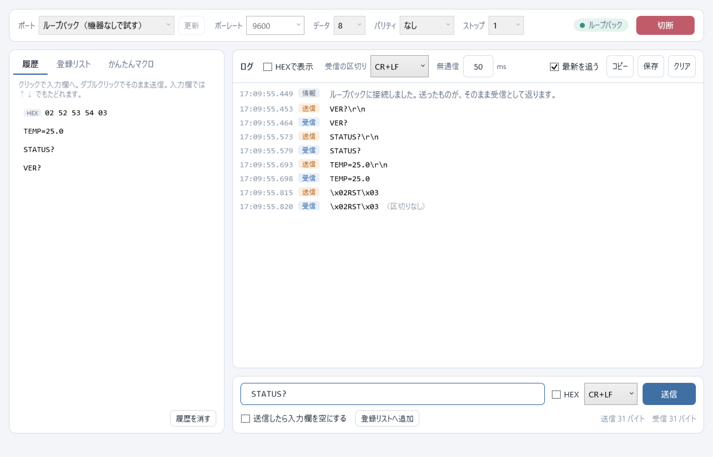
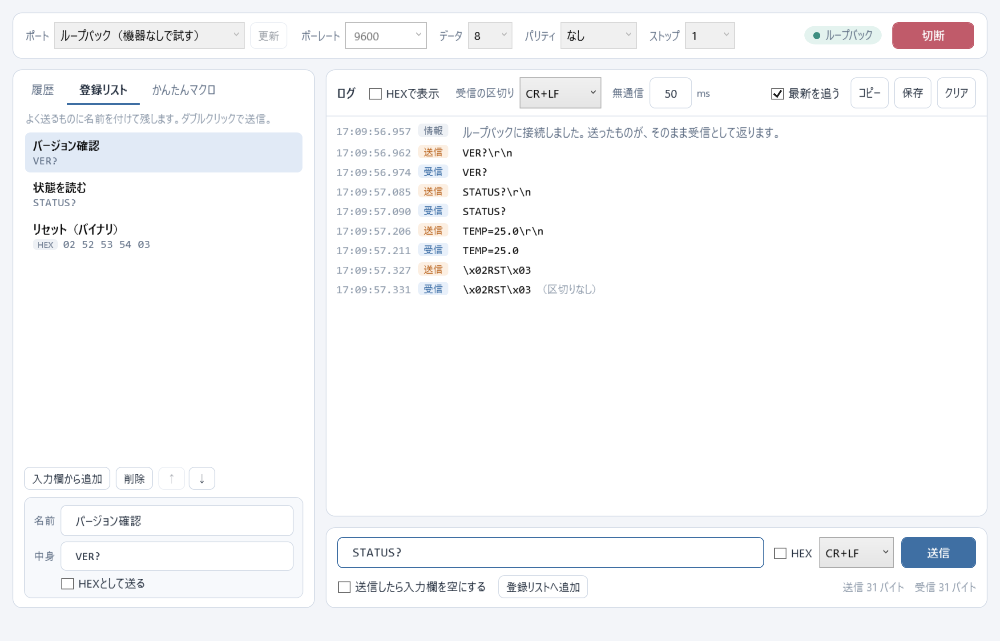
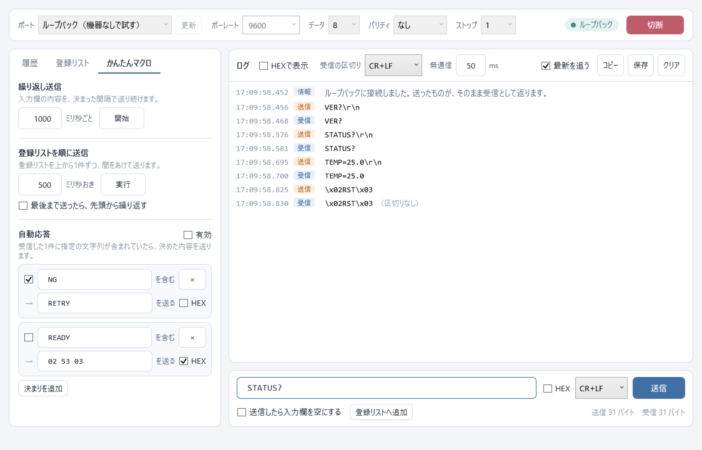

# Simple Serial Tester

シリアル通信（RS-232C、USBシリアルなど）の送受信を、手早く試すためのWindows用ツールです。WPF（.NET 8）で作っています。



## 何のためのツールか

多機能な端末ソフトの代わりではありません。機器へ命令を送って応答を見る、という試験を、迷わずにできることだけを狙っています。

- **送ったものが履歴に残る。** 選べば入力欄に戻るので、少し直して送り直すのが楽です。入力欄では ↑↓ キーでもたどれます
- **かんたんなマクロ。** 同じ内容を一定間隔で送る、登録したものを順に送る、受信に応じて決めた内容を返す、の3つだけ
- **できることを絞る。** スクリプトも画面のカスタマイズもありません。設定は1画面に収まります

10年以上前に自分用に作ったツール（C#、Windowsフォーム）を、同じ考え方のままWPFへ置き換えたものです。置き換えの実装は、AI（Claude Code）に頼みました。元のツールのコードは含みません。

作った経緯と、置き換えで直した点は、次の記事に書きました。

- [10年以上前に自作したシリアル通信の試験ツールを、AIにWPFへ置き換えてもらった（Qiita）](https://qiita.com/okakousuke1124/items/ae982344111c31542d21)

## 機能

### 送信

- 文字列、または16進数（HEX）で送信。HEXは `02 41 03`、`0x02,0x41`、`024103` のどの書き方でも読みます
- 文字列の末尾に足す改行コードを選べます（CR+LF、CR、LF、なし）。HEXのときは足しません
- Enterキーで送信

### 履歴と登録リスト

| 履歴 | 登録リスト |
| --- | --- |
| 送ったものが自動で残る（同じ内容は1件にまとめ、新しい順） | よく送るものに名前を付けて残す |
| クリックで入力欄へ、ダブルクリックで送信 | ダブルクリックで送信、並べ替え可 |



### かんたんマクロ

- **繰り返し送信**：入力欄の内容を、指定の間隔（50〜60000ミリ秒）で送り続ける
- **登録リストを順に送信**：上から1件ずつ、間をあけて送る。繰り返しも可
- **自動応答**：受信した1件に指定の文字列が含まれていたら、決めた内容を送る

自動応答は、応答が応答を呼んで止まらなくなることがあります。1秒に20回を超えたら、自動で止めます。



### ログ

- 送信と受信を、1つの時系列に並べます。時刻はミリ秒まで
- 表示は文字列とHEXを切り替えられます。切り替えると、既にあるログも書き換わります
- **受信は「1件」ごとに区切ります。** シリアルポートからの通知は、電文の切れ目で来るとは限りません。1件が2回に分かれて届いても、改行コードまでを1行にまとめます
- 改行コードが来ないまま続きが途絶えたら、指定の時間（既定50ミリ秒）で確定し、「区切りなし」と添えます
- 行を選んでコピー（Ctrl+C）、テキストファイルへ保存

保存したログは、タブ区切りで「時刻、向き、中身、補足」の順です。

```text
2026-11-11 15:04:05.678	送信	VER?\r\n
2026-11-11 15:04:05.690	受信	VER 1.02
```

### 機器なしで試す

ポートの一覧にある「ループバック（機器なしで試す）」を選ぶと、送ったものがそのまま受信として返ります。実機に近づけるため、1件を2つの断片に分けて返します。

## 動かし方

.NET 8 以降のSDKが必要です。

```shell
dotnet run --project src/SimpleSerialTester
```

テストは次のとおりです。

```shell
dotnet test
```

設定（接続条件、履歴、登録リスト、自動応答）は、終了時に `%AppData%\SimpleSerialTester\settings.json` へ保存します。

READMEの画面の画像は、次のコマンドで作り直せます。架空の命令をループバックへ送った画面を保存します（設定ファイルは読み書きしません）。

```shell
SimpleSerialTester.exe --screenshot docs/screenshot.png --tab 0
```

## 構成

| フォルダ | 中身 |
| --- | --- |
| `src/SimpleSerialTester.Core` | 画面に依存しない処理。HEXの変換、受信を1件ずつに区切る処理、自動応答、設定の保存、ポートの入出力 |
| `src/SimpleSerialTester` | WPFの画面とViewModel |
| `tests/SimpleSerialTester.Core.Tests` | Coreの単体テスト |
| `tests/SimpleSerialTester.Tests` | ViewModelをループバックにつないで動かすテスト |
| `tools/ChunkProbe` | 受信の通知が電文の切れ目で来るかを確かめる、確認用のコンソールプログラム |

外部のライブラリは、`System.IO.Ports` とテスト用のxUnitだけです。

## 受信がどこで分かれて届くかを確かめる

`tools/ChunkProbe` は、数行を送って受け、同じ受信データを「通知が来た単位のまま」と「改行コードで区切り直した単位」の2通りで表示します。

```shell
# 機器なし（ループバック）
dotnet run --project tools/ChunkProbe

# 実際のポート。TXとRXを折り返しておく
dotnet run --project tools/ChunkProbe -- --port COM7 --baud 9600 --lines 5 --length 40
```

## 確認した範囲

2026年11月、Windows 11、.NET SDK 10.0.402（`net8.0-windows` 向けにビルド）で確認しました。

- 自動テスト64件（Core 50件、ViewModel 14件）が通ること
- ループバックでの送受信、履歴、登録リスト、3つのマクロ、設定の保存と復元

**実際のシリアルポートにつないだ確認は、まだしていません。** 開発に使ったPCに、試験に使えるポートが無かったためです。実機で使う前に、手元の機器で送受信を確かめてください。

## 入れていないもの

- フロー制御（RTS/CTS、XON/XOFF）と、DTR・RTSの手動操作
- 文字コードの選択（文字列はUTF-8として扱います。それ以外はHEXで送受信してください）
- チェックサムやCRCの自動計算
- スクリプト、条件分岐のあるマクロ
- ログの自動保存（保存ボタンで保存します）

## ライセンス

MIT License。[LICENSE](LICENSE) を参照してください。
